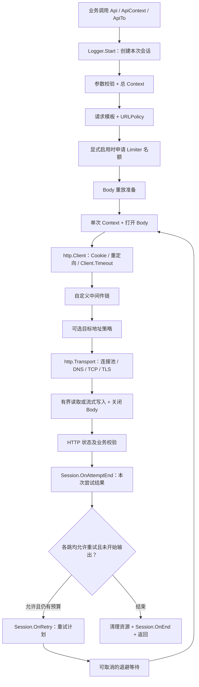

# requests 功能与架构说明

本项目是供 Go 业务程序调用的 HTTP 请求库。它负责构造请求、复用客户端、发送 HTTP 请求、控制超时与重试、读取响应、校验业务结果以及记录日志；没有独立监听端口、数据库或后台任务服务。

本版面向 Go 1.26.0 及以上版本，不提供旧签名、旧中间件 Context 协议或旧工具链的兼容实现。公开入口统一采用明确的错误返回和支持 Context 的业务验证接口，具体规则见“接口约定”。

## 功能说明

### 请求入口

| 入口 | 用途 |
| --- | --- |
| `requests.Api(client, p)` | 使用 Background Context 的便捷请求入口 |
| `requests.ApiContext(ctx, client, p)` | 继承调用方取消信号和期限 |
| `requests.ApiTo(ctx, client, p, dst)` | 将成功响应流式写入 Writer，返回写入字节数、Header 和 error |
| `requests.NewClient(cmd)` | 返回 (*http.Client, error)，创建或复用配置相符的命名客户端 |
| `requests.GetClient(name)` | 只取得已有命名客户端，不重新提交配置 |
| `requests.NewClientUncached(cmd)` | 每次创建独立客户端，适合租户或动态配置 |
| `requests.NewPublicClient(cmd)` | 创建独立公网客户端，强制阻止非公网 IP 并禁用环境代理 |
| `tc.ContentBy...` | 构造 JSON、XML、文本、二进制、MsgPack 和表单 Body |
| `tc.FileBodyFactory(path)` | 为大型二进制文件创建可重放流 |
| `tc.FileBodyFactoryUnder(root, relative)` | 使用 os.Root 将外部相对路径限制在授权目录内 |
| `pf.ReadRequestBody/ReadResponseBody` | 有界读取并恢复 Body；也提供显式 Limit 版本 |

`Api` 和 `ApiContext` 返回 `([]byte, http.Header, error)`。失败时也可能返回部分或完整的错误正文及响应头，调用方应先检查 error，再决定如何处理这些数据。

支持 GET、POST、PUT、PATCH、DELETE、HEAD、OPTIONS、TRACE、CONNECT。方法需大写。HTTP/HTTPS URL 必须完整，禁止在 URL 中携带用户名和密码；认证使用请求头。

`Params` 追加到 URL 中已有的查询参数，同名键可以有多个值；非法百分号编码和未转义的分号会在发送前报错。`Header["Host"]` 设置的是 `Request.Host`；Content-Length 会解析、校验并设置到请求字段。显式声明 `Content-Length: 0` 时，在单次期限内最多探测一个字节确认空正文，非空正文在发送前拒绝，空流关闭后转为 `http.NoBody`。Transfer-Encoding 由 Go HTTP 层管理，不允许通过普通请求头覆盖。

### ApiParam 参数

| 参数 | 规则或默认值 |
| --- | --- |
| `Url / Method / Header / Params` | URL、方法、单值请求头、追加的查询参数 |
| `Body` | 一次调用拥有的 io.Reader，若支持 Close，会在成功或失败路径关闭 |
| `BodyFactory` | 每次尝试返回独立 io.ReadCloser、长度和 error；未知长度返回 -1；与 Body 互斥 |
| `SingleTimeout` | 单次尝试期限，默认 30 秒 |
| `Timeout` | 整次调用期限，0 自动计算 |
| `Retry` | 首次之外的额外尝试次数，范围 0～100 |
| `RetryInterval` | 固定间隔；0 时使用带抖动的指数退避 |
| `Backoff` | 可自定义退避，参数从第 1 次重试开始；优先于 RetryInterval |
| `MaxRetryDelay` | 单次等待上限，默认 30 秒，包含 Retry-After 的等待 |
| `AllowUnsafeRetry` | 显式允许有副作用的方法重试，默认 false |
| `RetryStatusCodes` | nil 默认 408、429、500、502、503、504；空切片关闭状态码重试 |
| `RetryValidation` | 显式允许业务校验失败后重试，默认 false |
| `RetryDecider` | 可覆盖普通失败的重试判断；不能绕过方法、永久错误、地址、容量和写入限制 |
| `EnableValid` | 是否启用业务验证，默认 false |
| `Validator` | `func(context.Context, []byte, http.Header) (bool, error)`；回调应响应取消和期限 |
| `SuccessStatus` | 自定义 HTTP 成功状态；默认接受 200～299 |
| `MaxResponseBytes` | 响应正文上限，默认 16 MiB |
| `MaxErrorBytes` | 错误正文上限，默认 64 KiB；实际取其与 MaxResponseBytes 的较小值 |
| `MaxReplayBytes` | 一次性流的重试缓存上限，默认 8 MiB |
| `URLPolicy` | 初始地址和每次重定向的业务地址检查；不能替代实际拨号 IP 检查 |
| `MaxRedirects` | 最多跟随的重定向次数，0 默认 10，范围 0～100 |
| `AllowCrossOriginRedirect` | 允许不同协议、主机或有效端口之间跳转，默认 false |
| `AllowHTTPSDowngrade` | 允许 HTTPS 跳转 HTTP，按相邻两跳检查，默认 false |
| `AllowCrossOriginBody` | 允许跨源重放正文，默认 false，需要独立于重试配置授权 |
| `RedirectHeaderAllowlist` | 跨源可携带的头；nil 默认 Accept、Accept-Language、Content-Type、User-Agent；空切片全部移除 |
| `Limiter` | 显式设置一组调用共用的并发/正文容量限制；nil 关闭，跳过共享预算计算及名额申请 |
| `Logging` | `*logging.Config`；nil 关闭，空配置使用内置 slog，自定义 Logger 替换内置输出 |
| `Caller / TraceId` | 日志中的调用方和跟踪标识 |

时间参数均为 `time.Duration`，例如 `500*time.Millisecond`。整数 `500` 表示 500 纳秒。

ApiParam 容量字段的 0 表示使用默认值，不表示无限制。负数、无效 URL、无效 Header、冲突配置以及错误的重试次数会被拒绝。`tn.NewLimiter(maxConcurrent, 0)` 是单独的构造器规则，表示只限制调用数。

日志配置与事件协议位于独立公开的 [logging 包](../logging/README.md)。`Config.Capture` 分别控制请求/响应头与正文，正文上限每个方向默认 4 KiB；`Config.Redactor` 控制脱敏。`Logger.Start` 为整次调用创建独立会话，依次接收尝试完成、重试计划及最终结束事件。显式启用 Limiter 的正文容量限制后，日志采集缓存也计入该预算。

### 超时与取消

总期限覆盖配额排队、Body 准备、各次请求、响应读取或流式写入、业务校验及重试等待；调用方 Context 期限更短时，以调用方为准。

一次尝试的 SingleTimeout 覆盖 BodyFactory 打开、显式零长度正文探测、HTTP 交互、响应读取或流式写入和业务校验。一次性流在首次发送前的重试缓存准备属于总期限。Client.Timeout 对其自身的 HTTP 交互和读取继续生效。

Timeout 未设置时，按以下方式计算，溢出时饱和到最大 Duration：

```text
总期限 = SingleTimeout × (Retry + 1) + 等待预算 × Retry
等待预算 =
  固定 RetryInterval 与 MaxRetryDelay 的较小值，或
  使用默认/自定义退避时的 MaxRetryDelay
```

实际等待可能受服务端 Retry-After 影响，总期限始终优先，因此配置了较短固定间隔时，服务端较长的等待建议可能导致整个调用超时。

取消错误保留 `context.Canceled` 或 `context.DeadlineExceeded`，可用 `errors.Is` 判断。超时后返回成功的验证器也会被纠正为超时。原本已经失败时，期限复核会合并 Context 原因并保留原始错误链；NoRetry、Writer 错误、容量超限等禁止重试依据不会被超时覆盖。错误可能包含多个原因，应使用 `errors.Is/As` 分类。

任意用户代码无法被 Go 安全地强制终止。BodyFactory、Validator、RetryDecider 和 URLPolicy 必须配合 Context；自定义流的 Close 应能解除阻塞的 Read。不响应取消的验证器、不支持关闭的阻塞 Reader，以及不响应取消的 Writer.Write 可能延长实际返回时间。Backoff、SuccessStatus、日志输出和资源清理也同步执行，应使用能够及时返回的实现。本库不为这些回调创建无法回收的后台 goroutine。

内置文件工厂在 Unix 使用非阻塞打开并检查已打开文件的类型，拒绝 FIFO、目录和其他特殊文件，包括指向它们的符号链接。Context 会在打开和检查前后复核；网络文件系统等内核操作仍无法被 Context 强制中断，不应据此承诺任意文件系统都能立即取消。

### 重试规则

只有同时满足下列条件才会继续尝试：

1. 配置的 Retry 次数尚未用完，且总 Context 仍有效。
2. 初始请求及实际跟随的每一跳，方法为 GET、HEAD、OPTIONS，或显式设置 AllowUnsafeRetry，或携带非空白 Idempotency-Key / X-Idempotency-Key。
3. 遇到可重试状态码、临时网络故障、单次超时、不完整响应读取，或显式允许重试的业务校验失败。
4. 请求正文能够重新打开，或已经在容量上限内完成缓存。

业务校验失败默认不重试，临时业务状态可设置 `RetryValidation: true`。`RetryDecider(ctx, info)` 可覆盖普通失败的默认判断，`info.Attempt` 从 1 开始，`Header` 为独立副本。用 `tn.NoRetry(err)` 标记永久业务失败；该标记以及取消、证书错误、地址拒绝、Body 不可重放、容量超限和 Writer 写入错误都不能被 RetryDecider 放行。参数和 BodyFactory 打开错误在发送前返回。

整次显式重试会重新执行跳转链。跨源清理或自定义 CheckRedirect 导致某个非安全方法请求失去幂等键后，本次调用不再自动重试，即使最后一跳已经变成 GET。这个限制在目标请求发生网络错误、尚未拿到响应时也生效。只有显式 AllowUnsafeRetry，或让每个相关目标都携带且支持同一操作的幂等键，才可继续重试；不要为了重试而向未经授权的目标透传凭证。

默认指数退避基值 100 毫秒，指数部分最高 2 秒，在其一半到完整间隔之间加入抖动。显式设置 RetryInterval 可保留固定间隔；Backoff 可自定义。所有等待都响应取消，并受 MaxRetryDelay 限制。

Idempotency-Key / X-Idempotency-Key 只有在服务端实现去重时才有意义；客户端不会提供“只执行一次”的事务保证。两个头的空字符串和纯空白值会从实际请求中移除，不会修改调用方的 Header 配置；重定向回调写入的空值也会在发送前移除。有效值保持原文，回调写入多值时仅删除空白项。AllowUnsafeRetry 表示调用方承担重复操作的业务风险。Go Transport 自身可能对可重放请求进行透明连接重试，Retry 统计的是本库的显式重试，设为 0 也不禁用 Transport 对有效幂等请求的透明重发。

### HTTP 状态和业务校验

HTTP 状态默认接受全部 2xx。若业务需要接受 304 等状态，可配置 SuccessStatus。

启用 EnableValid 且未传入验证器时，保留原约定：

```json
{"code": 200, "msg": "success"}
```

验证发生在重定向完成并读取最终响应之后。`false, nil`、任意非 nil error 和验证器 panic 都视为校验失败。`true, error` 不会被当作成功。原始业务错误通过包装保留，panic 内容不会写入错误信息。

常用错误判断：

```go
body, header, err := requests.ApiContext(ctx, client, p)

var statusErr *tn.HTTPError
switch {
case errors.Is(err, context.DeadlineExceeded):
    // 上游期限、总期限或单次尝试超时
case errors.As(err, &statusErr):
    // statusErr.StatusCode / Header / Body / Truncated
case errors.Is(err, tn.ErrResponseTooLarge):
    // 正文超限；不会将截断内容视为成功
case errors.Is(err, tn.ErrRequestBodyTooLarge):
    // 改为 BodyFactory，或明确提高 MaxReplayBytes
case errors.Is(err, tn.ErrTargetBlocked):
    // 地址策略拒绝
case errors.Is(err, tn.ErrClientConfig):
    // 客户端配置无效或命名缓存配置冲突
case errors.Is(err, tn.ErrAdmissionTooLarge):
    // 单次正文预算超过共享 Limiter 总容量
case errors.Is(err, tn.ErrResponseWrite):
    // ApiTo 的 Writer 写入失败，可能已有部分输出
case errors.Is(err, tn.ErrValidation):
    // HTTP 成功但业务验证失败
}
_ = body
_ = header
```

错误响应超限可能同时满足 HTTPError 和 ErrResponseTooLarge；请按业务需要安排判断顺序。HTTPError.Error() 不输出 URL 和 Body，但 error 对象及返回正文仍可能包含业务敏感信息，调用方不要直接写入公开日志。

### Body 构造和文件上传

| 构造方法 | 行为 |
| --- | --- |
| `ContentByJson([]byte)` | application/json，保留原字节，不负责 JSON 模式校验 |
| `ContentByXml([]byte)` | application/xml，保留原字节，不解析 XML |
| `ContentByRaw(string)` | text/plain |
| `ContentByBinary(any)` | []byte、*os.File 或 io.Reader；文件长度按当前偏移计算 |
| `ContentByMsgpack(map[string]any)` | application/x-msgpack |
| `ContentByXWFormUrlencoded(map[string]any)` | 标量、基础类型别名及一层切片/数组；切片编码为同名多值 |
| `ContentByFormData(map[string]any)` | 普通字段、FormFile 和 []FormFile；惰性 multipart 流 |
| `FileBodyFactory(path)` | 每次重新打开普通文件，适合大型二进制请求 |
| `FileBodyFactoryUnder(root, relative)` | 使用 os.Root 限制在授权目录内，拒绝目录穿越和符号链接逃逸 |

不支持的表单值会返回错误，不再静默丢失字段。空切片不产生字段，整个表单没有有效字段时返回错误。

multipart 构造只生成小块 MIME 头和打开文件的方法，不打开文件、不启动 goroutine。文件读到哪个 part 才打开哪个文件，用完立即关闭。字段名、文件名拒绝 CR/LF/NUL；引号和非 ASCII 字符使用 MIME 标准编码；文件名移除路径部分。

FormFile.Content 保留三种语义：

- string：本地文件路径，每次发送独立打开，可重试。
- []byte：内存内容，可重试；调用过程中不得修改底层切片。
- io.Reader：一次性流；若需要重试，会受 MaxReplayBytes 限制。

本地文件路径必须来自可信配置，或先经过业务层授权。multipart 的字符串路径功能不适合直接接受外部用户提交的任意路径；文件名净化不等于文件访问授权。每次重试/重定向期间文件内容需保持稳定。

需要接受外部相对路径时，可使用 `BodyFactory: tc.FileBodyFactoryUnder(authorizedRoot, relativePath)`。root 本身必须经过授权，目录范围限制也不能替代目录内文件的业务权限检查。工厂只接受普通文件；Unix 下对 FIFO 及其符号链接使用非阻塞打开后拒绝。multipart 如需同样的目录权限控制，可在 BodyFactory 中为每次尝试打开受限文件并构造独立 multipart 流。

大型二进制文件：

```go
p := tn.ApiParam{
    Url:         "https://upload.example.com/files",
    Method:      "POST",
    Header:      map[string]string{
        "Content-Type": "application/octet-stream",
        "Idempotency-Key": operationID, // 服务端必须支持去重
    },
    BodyFactory: tc.FileBodyFactory(trustedPath),
    Retry:       2,
    Timeout:     2 * time.Minute,
    SingleTimeout: 30 * time.Second,
}
body, header, err := requests.ApiContext(ctx, client, p)
```

multipart 文件：

```go
reader, contentType, err := tc.ContentByFormData(map[string]any{
    "user": "alice",
    "tag": []string{"report", "daily"},
    "file": tc.FormFile{Filename: "report.csv", Content: trustedPath},
})
if err != nil {
    return err
}
_, _, err = requests.ApiContext(ctx, client, tn.ApiParam{
    Url: "https://upload.example.com/form",
    Method: "POST",
    Header: map[string]string{
        "Content-Type": contentType,
        "Idempotency-Key": operationID,
    },
    Body: reader,
    Retry: 2,
})
return err
```

Body 的所有权交给一次 Api 调用。创建 Body 后如果最终没有调用 Api，应自行关闭实现 io.Closer 的 Body。不要将同一个流交给并发调用；若需并发上传，分别创建 Body，或者让 BodyFactory 每次返回独立流。

Api/ApiContext 返回完整的有界响应字节切片；流式下载使用 ApiTo。

### 流式下载

`ApiTo(ctx, client, p, dst)` 将成功正文用固定 32 KiB 缓冲区复制到 Writer，返回 `(int64, http.Header, error)`。MaxResponseBytes 仍然限制写入量，超限时不会写入用于探测的额外字节。失败 HTTP 状态的正文按 MaxErrorBytes 有界读取，可从 `HTTPError.Body` 获取。

```go
written, header, err := requests.ApiTo(ctx, client, tn.ApiParam{
    Url:              downloadURL,
    Method:           "GET",
    Retry:            2,
    MaxResponseBytes:  1 << 30, // 明确限制为 1 GiB
    Timeout:          10 * time.Minute,
    SingleTimeout:    5 * time.Minute,
}, dst)
```

ApiTo 要求非 nil Context 和 Writer，且 `EnableValid=false`；返回成功前仍检查 HTTP 状态、容量和期限。库不会关闭 dst。写入开始后的任何失败都不自动重试；Writer 的错误即使发生在首次写入且返回 0 字节，也不会重试。只有尚未写入时的可重试 HTTP/读取错误才可能继续。文件下载应先写临时文件，检查 error 并成功关闭后再提交或重命名，避免将部分文件当成完成结果。

### 共享并发和正文预算

Api、ApiContext 和 ApiTo 默认不使用 Limiter。`p.Limiter=nil` 时不计算共享正文预算、不申请名额，也不竞争 Limiter 的计数锁。请求数量和所有调用的合计资源占用由应用程序控制；单次 Body 大小限制仍独立生效。

使用者通过 `tn.NewLimiter` 创建实例，再显式赋给 `p.Limiter`。同一指针用于哪些调用，哪些调用就共同计数，与 URL、域名或 Client 是否相同无关；不同实例分别计数。每个调用各自新建实例无法限制这些调用的合计数量。实例创建后配置固定，开始使用后不能复制。

`NewLimiter(maxConcurrent, 0)` 只限制调用数量，并跳过共享正文预算计算；第二个参数为正时，才同时启用容量限制。maxConcurrent 必须为正数，容量不能为负数。非 nil 但没有通过构造器创建的实例会在参数检查阶段被拒绝。

```go
limiter, err := tn.NewLimiter(100, 0) // 只限制调用数。
if err != nil {
    return err
}
pA.Limiter = limiter
pB.Limiter = limiter // 与 A 共同受到 100 个调用的限制。
pC.Limiter = nil     // 不参加 A、B 的限制。
```

如需同时限制正文容量，使用 `NewLimiter(100, 512<<20)`。普通调用按 MaxResponseBytes 预留；需要缓存一次性上传流以重试时，加上 MaxReplayBytes；日志会话启用了请求/响应正文采集时，再加上对应采集上限。ApiTo 的响应部分预留 `min(MaxErrorBytes, MaxResponseBytes) + 32 KiB`。显式 Content-Length: 0 的流确认空正文后不需要重试缓存，因此也不预留重放预算。两项限制必须同时满足，实际可并发数量可能低于 maxConcurrent。

申请发生在正文准备前。成功取得名额后，正文准备、各轮尝试、重试等待均共用一次申请，退出时归还；不会每轮重新申请。所有返回路径负责清理流及归还已经取得的名额，OnEnd 在两者完成后派发。等待期间取消或总 Timeout 到期立即结束，尚未开始任何尝试；SingleTimeout 从各轮开始计算。当前剩余容量不足时等待，单次预算超过总容量或预算相加溢出时直接返回 ErrAdmissionTooLarge。多个等待者竞争可用名额，不保证严格按照到达顺序放行。

`CallResult.LimiterWaitDuration` 记录 Acquire 从调用到返回的耗时（含检查开销，成功和失败均统计），属于总 Duration 的一部分；未启用 Limiter 或在申请前失败时为 0。各轮的 AttemptResult.Duration 不包含这次等待。申请失败的最终 Phase 为 admission、尝试数为 0，错误通过正常返回值及最终日志呈现，不触发日志异常回调 OnError。

容量预算不是预分配内存，也不是进程峰值内存上限。它不包含 io.ReadAll 扩容、重试时仍保留的上一轮结果、用户回调自行保存的历次快照、协议缓冲，以及调用结束后由业务保留的结果。使用者应管理总体并发和数据保留时间；大下载可通过 ApiTo 写入文件等流式目标。

已移除进程全局的 SetDefaultLimiter。需要整个应用统一限制时，由使用者在自己的统一请求封装中显式注入同一实例。

## 架构说明

### 模块职责

| 模块 | 职责 |
| --- | --- |
| 根包 requests | 请求/流式输出入口、共享预算配置及客户端选择 |
| tn | 请求/客户端配置、Limiter、BodyFactory/BodySource、验证器及结构化错误 |
| logging | 仅依赖标准库的日志协议、事件快照、脱敏、回调隔离和默认 slog 输出 |
| internal/runner | 配额排队、请求构造、超时、重放、重试、重定向、流式输出、校验与日志协调 |
| internal/core | Client 创建、连接池默认配置、LRU 缓存、网络访问策略 |
| mdw / interfaces | 自定义 RoundTripper 建链、克隆约定及中间件工厂 |
| tc | 编码和惰性 multipart；文件流打开方法 |
| pf | 有界读取并恢复 Body 的辅助方法 |
| internal/lz | 有界读取、仅关闭一次、读取后恢复正文 |
| internal/validator | 默认业务验证及回调错误/panic 处理 |
| internal/utils / idgen | 类型转换、通用辅助和请求 ID |



重试置于 http.Client 之上，因此能覆盖完整的一次重定向过程，并对默认及自定义 Client 使用一致策略。BodyFactory 为本次尝试和 307/308 重定向生成独立流。

重试和业务校验由 Api/ApiContext/ApiTo 执行，执行层把日志事件交给独立 logging 包派发。request_id 标识单次调用，TraceId 标识业务链路，二者独立。参数无效、排队失败等提前返回路径也会派发 OnEnd。执行层不注入中间件元数据，也不读取旧 Context 协议。自定义中间件通过 Client 的 Transport 链执行，直接 Client.Get/Do 不自动获得 Api 系列的执行策略。

### 资源生命周期

1. Api 接管传入 Body；即使参数错误或调用方已取消，也清理可关闭的流。
2. 可重放字节流使用 GetBody，可重建文件使用 BodyFactory/BodySource，不提前缓存文件。
3. 只有需要显式重试的一次性流会进入有界缓存；读取失败直接返回原始错误。
4. 每次尝试独立创建 Context 和 Body；响应读完后关闭，随后取消该次 Context。
5. 响应超限或失败时关闭流，不无限排空可能由远端持续发送的数据；该连接可能无法复用。
6. 正常读取至 EOF 的响应由 Go HTTP 层归还连接池。
7. 缓存替换/淘汰调用 CloseIdleConnections，在途请求继续执行。
8. 调用结束不关闭整个共享 Client；调用方可以显式关闭其空闲连接。
9. 调用结束时归还显式取得的 Limiter 名额；流式 Writer 及其已写入的结果仍由业务持有和提交。

重复关闭通过同步保护，防止正常清理与取消回调同时关闭底层资源。流本身仍需满足 net/http 的 Read/Close 并发约定。

### 客户端缓存与连接池

ClientParam 包含 Timeout、SpaceName、Transport、Jar、Middlewares、MiddlewareFactories、CheckRedirect、Reset、NetworkPolicy 和 MaxConnsPerHost。

- 空 SpaceName 使用 master；同名且配置签名相符才返回同一 Client，更新使用 Reset。
- 命名缓存容量为 100，使用互斥锁保护 LRU 操作。
- Timeout、连接上限、NetworkPolicy、Transport、Jar 或中间件原型等配置冲突，返回 ErrClientConfig。
- CheckRedirect 和 MiddlewareFactories 等回调不能可靠比较；即使再次传入同一函数变量，也保守地视为配置冲突。函数或非指针值形式的 Transport/Jar/中间件身份也采用保守比较。
- 已有客户端用 GetClient 读取；动态回调或租户隔离用 NewClientUncached，SpaceName/Reset 在该入口不参与缓存。
- NewPublicClient 也不进入命名缓存；始终启用 BlockPrivateIPs，保留传入 NetworkPolicy 的 AllowedHosts，并拒绝自定义 Transport。
- NewClient、NewClientUncached 和 NewPublicClient 均返回 (*http.Client, error)，配置错误在创建阶段返回。Transport/Jar 中保存的带类型 nil 均被拒绝，真正的 nil Jar 表示不启用 CookieJar。
- 命名缓存与 Api(nil, p) 的共享默认 Client 独立。
- 默认最大空闲连接总数 500，每目标最大空闲连接 100；MaxConnsPerHost 默认 0，不设置每目标连接总数上限，正值由使用者显式限制，负数拒绝。0 与 256 是不同配置，命名缓存不会混用。
- 默认空闲连接期限 90 秒，拨号预算 30 秒，TLS 握手预算 10 秒，Expect-Continue 等待 1 秒。
- 使用 HTTP/2 自动协商；不关闭证书校验。
- 未启用 NetworkPolicy 时支持环境代理；启用后禁用环境代理，确保 IP 检查发生在实际拨号处。
- 不再额外硬编码 5 秒的响应头超时；由单次请求/Client 期限控制。

缓存构造、用户工厂和空闲连接清理在锁外执行，避免慢回调、重入或 panic 锁住整个缓存。并发首次创建可能产生多个独立候选，提交时只保留一个，未采用候选会关闭空闲连接。

连接上限与请求并发数不同，HTTP/2 中同一连接可以执行多个请求。Api 系列仅在 p.Limiter 非 nil 时限制一组调用；直接 Client.Do/Get 不经过这一步。自定义 Client/Transport 的连接设置由使用者控制。应用仍需管理自身任务排队及返回结果的保留时间。

自定义 Transport 的池配置由调用方负责；不要并发修改已使用 Client/Transport 的字段。缓存淘汰不使外部保存的 Client 失效，因此长期自行持有大量 Client 时，资源总量不受缓存条目数限制。

### 中间件扩展约定

Middlewares 节点实现 RoundTripper、SetTransport、Name，且必须实现 `interfaces.Cloner` 返回独立节点；仅为每个 Client 手工创建实例、但不实现 Clone，会被拒绝。构建不会修改共享原型。

也可使用 `MiddlewareFactories`，每个工厂接收下游并返回独立、支持并发的 RoundTripper。工厂列表位于 Middlewares 节点外侧，两份列表内部均按从外到内的顺序执行，不能返回跨客户端共享的可变节点。开始发送请求后不要继续 Build 或修改下游。

Build 拒绝 nil、重复原型、返回原节点的 Clone 和已检测到的循环；原型与 Clone 结果都在 map 操作前检查实际值可比较性，interface 字段内保存切片等不可比较值时返回错误。指针中间件内部仍可持有切片或 map。NewClient 将建链错误返回给调用方。中间件应遵守 RoundTripper 的并发、响应和 Body 关闭约定。链包装器优先调用最外层的 CloseIdleConnections；外层未实现时关闭基础 Transport 的空闲连接。自定义节点实现该方法时需继续向下游转发，自有其他资源由其所有者管理。

## 性能设计

| 原问题 | 调整 |
| --- | --- |
| 重试、日志、返回值多次读取同一个响应 | 正文只沿正常执行路径读取，日志按需复制经过的有界前缀 |
| 任意上传流提前读完，文件大小决定内存占用 | 可重建流直接发送，普通文件/multipart 路径按需打开 |
| multipart 创建即启动管道生产者 | 同步惰性顺序流，不创建生产者 goroutine |
| 日志预读完整请求/响应 | 开启预览时随发送捕获小前缀，默认日志完全不读取 Body |
| 缓存超过容量后整体重置 | 容量受限的 LRU，仅淘汰最近最少使用项 |
| 无限连接增长、频繁新建连接 | 客户端复用、连接池上限、空闲连接清理 |
| 使用者希望控制一组调用的数量和正文容量 | 显式传入共享 Limiter，在预读正文前申请；默认路径跳过该处理 |
| 大下载必须完整进入响应切片 | ApiTo 使用固定 32 KiB 复制缓冲，保留容量和错误处理规则 |
| 失败时立即密集重试 | 指数退避、抖动、服务端 Retry-After 和总期限 |
| 表单字段转换用格式化分配字符串 | 基础类型用 strconv，支持别名且拒绝不支持的值 |

读取上限限制的是保留的正文数据量。io.ReadAll 的扩容、解析/验证器以及用户日志 Sink 仍可能带来额外分配，不能将 MaxResponseBytes 直接当作进程峰值内存。

本地基准用于验证执行开销和流式分配，不代表线上吞吐。测试机为 Apple M3 Max / darwin arm64；最终数据见“验证记录”。

## 安全设计

### 敏感日志

`Logging` 非 nil 后开启日志，未指定 Logger 时使用结构化 slog。默认记录请求 ID、TraceId、Caller、方法、origin、尝试次数、状态和耗时；Header 和 Body 需在 Capture 中分别开启。自定义 Logger 完全替换内置实现。

- 不记录 URL 的路径、查询参数或 URL 用户信息，避免路径令牌泄漏。
- 请求/响应头仅允许 Content-Type、Content-Length、Accept 原值，其他值统一脱敏。
- Body 预览默认关闭。开启后仅处理完整且不超限的 JSON/URL 表单。
- 密码、token、cookie、secret、authorization、apikey、credential、session、privatekey 等字段及 `logging.DefaultRedactor.SensitiveFields` 会脱敏；JSON 递归处理。
- 非法 JSON、截断 JSON、大 Body、二进制、multipart、XML、纯文本整体省略。
- 日志不输出原始 error.Error()，防止其携带凭证 URL 或正文；记录错误类型。
- 内置输出包含 http.call.start、每次 http.attempt.end、计划重试时的 http.retry 及最终 http.call.end。每次尝试都能看到该次错误；慢请求期间不会预读正文。
- 自定义 Logger 接收已脱敏的快照；原始 Err 错误链仅供只读分类。回调 panic 被隔离并通过 Config.OnError 报告，不覆盖 HTTP 返回值。

字段规则不能识别任意自然语言中的秘密，也不是完整的个人信息识别器。处理敏感业务时关闭正文采集，或显式配置字段与受控的日志输出。自定义 Redactor 可以放宽默认规则，应按业务控制输出内容。Caller/TraceId 也应由业务填入适合记录的信息。完整生命周期、数据所有权及流式采集约定见 [logging 模块说明](../logging/README.md)。

CallResult.StatusCode 记录各轮 Client.Do 最近一次返回的最终响应状态；从未取得响应才为 0，不逐跳统计内部重定向。例如 503 后重试遭遇无响应的网络错误，最终状态仍为 503，但 Err 非 nil。RetryInfo 和 RetryEvent 只描述当前轮，无响应为 0；是否成功始终看 Err，单轮是否有响应看 AttemptResult.Response。

### 出站访问策略

NetworkPolicy 默认未开启，允许业务自行选择内网访问策略。若目标 URL 受外部输入影响，应显式启用受限客户端：

```go
client, err := requests.NewPublicClient(tn.ClientParam{
    NetworkPolicy: &tn.NetworkPolicy{
        AllowedHosts: []string{"api.example.com"},
    },
})
if err != nil {
    return err
}
```

NewPublicClient 始终启用 BlockPrivateIPs；需要命名缓存时可用 NewClient 并显式设置 NetworkPolicy。AllowedHosts 是精确主机名或 IP 列表，不接受通配符、端口、URL；国际化域名需提供 ASCII/Punycode。空列表不限制主机名。若需限制端口、路径或强制 HTTPS，再配置 URLPolicy。

启用策略后，内置 Transport 在每次目标请求检查主机名，DNS 解析后检查全部候选 IP，再直接拨号至已检查的 IP。IP 检查覆盖环回、内网、链路本地、IPv4 映射 IPv6、常见保留/特殊网段等；混合解析结果中有被拒绝地址时整体拒绝。DNS 与拨号共享时间预算，TLS 仍校验原始目标主机名。

此模式不允许自定义 Transport，并禁用环境代理，避免通过另一套拨号路径绕过检查。自定义中间件属于可信代码；若其自行发起额外网络请求，库无法替代系统级出站防火墙。业务层仍需对目标服务、路径、端口和操作进行授权。

URLPolicy 检查初始地址及每次实际跟随的重定向。默认拒绝跨源跳转；授权 AllowCrossOriginRedirect 后，仍需单独授权跨源正文重放。HTTPS 降级按相邻两跳判断，因此 HTTP→HTTPS→HTTP 中的第二次跳转也需要 AllowHTTPSDowngrade。自定义 CheckRedirect 先执行，随后检查其最终修改的目标、请求头和重试资格，不能借回调绕过这些限制。

允许跨源跳转时按 RedirectHeaderAllowlist 清理请求头，默认只保留 Accept、Accept-Language、Content-Type、User-Agent，Authorization、Cookie、自定义认证头和 Referer 都会移除。CookieJar 跨源取 Cookie 也默认禁用，只有显式将 Cookie 列入白名单才继续采用 Jar 的域规则。Cookie 本身仍不按端口隔离，租户隔离应使用独立 Jar/Client。被移除的 Idempotency-Key / X-Idempotency-Key 不会为了重试而自动补回；未启用 AllowUnsafeRetry 时，非安全方法失去幂等键后停止后续重试。

清理同时比较最初地址与上一跳：目标位于初始源之外时持续清理，跨源返回初始站点时也清理。因此 A→B→B→A 不会在 B 的站内跳转重新带入初始自定义凭证，也不会默认把 B 含查询参数的 Referer 带回 A。返回原站时，未列入白名单的手工请求头也会移除；CookieJar 仍按最初站点的隔离和域规则工作。

拒绝 307/308 重定向时，已通过 GetBody 重开的上传流也会关闭，包括 ErrUseLastResponse 分支。

### 工具链和依赖

本版实现以 Go 1.26.0 及以上版本为目标，文件目录限制直接使用 os.Root，不提供旧工具链分支。本次清理不修改 go.mod 的 go/toolchain 声明，版本配置由维护者另行升级。依赖本库的主模块需要独立设置构建工具链。

运行时依赖保持原固定版本，没有新增第三方运行时依赖。使用 [Go 官方 govulncheck](https://go.dev/doc/security/) 检查当前代码可达的已知漏洞；扫描结果只代表扫描时的代码、工具链和漏洞数据库，不替代后续持续更新。

## 接口约定

| 项目 | 当前行为 |
| --- | --- |
| 请求入口 | Api 使用 Background Context；ApiContext 接受上游 Context；ApiTo 支持流式输出 |
| 客户端构造 | NewClient 返回 (*http.Client, error)，无效配置及配置冲突在创建阶段返回 |
| Retry 含义 | 仍为额外次数；负数或超过 100 明确拒绝 |
| 非安全方法重试 | POST/PUT/PATCH/DELETE 等需安全开关或有效 Idempotency-Key / X-Idempotency-Key；任何跳转失去保护后停止整次调用的后续重试 |
| 业务重试 | 校验失败默认不重试；临时状态启用 RetryValidation，永久错误用 tn.NoRetry 标记 |
| 重定向 | 默认拒绝跨源和任意一跳的 HTTPS 降级；正文重放单独授权，跨源头和 Jar 均受白名单约束 |
| Client.Timeout | 直接使用 time.Duration，不再错误地再次乘以 time.Second |
| 返回状态 | 全部 2xx 默认成功；如必须只接受 200，设置 SuccessStatus |
| 非 2xx | 返回有界 Body/Header 和可 errors.As 的 HTTPError |
| Body 大小 | 默认响应 16 MiB、错误 64 KiB、重放 8 MiB；较大业务显式调高或使用流式工厂 |
| 大响应及并发 | ApiTo 支持固定缓冲下载；单次正文限制独立生效，Limiter 由使用者显式启用 |
| Content-Length: 0 | 发送前确认空正文；有数据即拒绝，避免隐式变成 chunked 上传 |
| 文件工厂 | 只接受普通文件；Unix 非阻塞打开防止 FIFO 挂死；受限目录入口使用 os.Root |
| Jar / CheckRedirect | 配置实际生效，重定向完成后才做业务校验 |
| 业务验证 | 统一使用带 Context 的 Validator；EnableValid 开启后默认检查 code/msg；非 nil error 优先于 true |
| 读流错误 | 不再被忽略，部分数据不会伪装成完整成功 |
| 日志 | 统一使用 ApiParam.Logging；Logger/Session 可替换内置输出，Capture/Redactor 分别控制采集和脱敏 |
| 中间件 | 节点必须实现 Clone，也可提供工厂；执行层不提供中间件 Context 注入协议 |
| multipart | 仍支持文件路径、字节、Reader；按需读取，不再创建即运行后台管道 |
| 表单未知类型 | 明确报错，避免静默丢字段；新增支持基础类型别名和 URL 表单多值 |
| URL credentials | 拒绝 user:password@host，改用认证头 |
| 客户端复用 | 同名且配置相符才复用；GetClient 显式取已有实例，Reset 替换，动态回调使用独立客户端 |
| nil 客户端配置 | 真正的 nil 使用默认语义；接口中保存的带类型 nil Transport/Jar 返回 ErrClientConfig |
| Go 工具链 | 目标为 Go 1.26.0 及以上版本，不提供旧工具链实现分支 |

上游 HTTP 服务应将 r.Context() 传给 ApiContext，让用户取消能够及时传递到出站调用。无需上游取消的简单场景可以使用 Api。

## 本轮复核修复

修复日期：2026-10-17。

| 问题 | 修复结果 | 回归场景 |
| --- | --- | --- |
| 跨源清理幂等键后仍重试 POST | 每跳复核；未启用 AllowUnsafeRetry 时，非安全方法丢失幂等键后停止整次调用的后续重试 | 503、网络错误、最终变为 GET、自定义 RetryDecider、显式保留幂等键和允许非安全重试 |
| HTTP→HTTPS→HTTP 绕过降级检查 | 使用上一跳 URL 判断 HTTPS 降级 | Api 覆盖默认拒绝及显式允许 |
| 文件工厂打开 FIFO 时无法取消 | Unix 非阻塞打开后检查文件类型，关闭被拒绝的描述符 | 普通及目录受限工厂，FIFO 与指向 FIFO 的符号链接 |
| 带类型 nil CookieJar 导致 panic | 创建阶段返回 ErrClientConfig | 命名、独立及公网客户端入口 |
| Content-Length: 0 意外发送 chunked 正文 | 最多探测一个字节，非空流拒绝，空流关闭并转为 NoBody | Reader、BodyFactory、BodySource、取消、只提供首字节的流、空流重试及预算 |

回归用例位于 `redirect_safety_test.go`、`request_boundary_test.go` 和 `tc/file_open_unix_test.go`。测试同时检查错误传播、跳转次数、实际 HTTP 序列化及正文关闭次数。

## 验证记录

本次清理以 Go 1.26.0 及以上版本为验证目标。自动化回归使用本机 httptest 或内存 Transport；手动访问外网的 TestK1 不纳入回归命令。

2026-11-13 清理后复核：使用本机 Go 1.26.2，借助临时 `-modfile` 声明 `go 1.26.0`，全包编译、完整回归与竞态检测（跳过 TestK1）、go vet 均通过。项目 go.mod 和 go.sum 未修改，版本声明由维护者另行升级。

2026-11-14 显式 Limiter 调整复核：使用当前 go.mod 指定的 Go 1.26.2，完整回归、全项目竞态检测和 go vet 均通过，跳过手动外网 TestK1。新增测试验证了 128 个未配置 Limiter 的调用同时进入内存 Transport、只限制并发时跳过会溢出的正文预算、不同实例隔离、等待取消、提前失败后归还名额，以及重试共用名额和 OnEnd 前归还名额。客户端测试同时覆盖默认连接上限为 0、自定义 Transport 保持原配置，以及 0/256 不再共享命名缓存。

同机本地并发基准：Apple M3 Max / darwin arm64、Go 1.26.2、GOMAXPROCS=14、SetParallelism(4)，内存 Transport 返回 2 字节响应，日志关闭。以下取三次样本的中位数；未配置实例的场景在调整前使用旧全局 Limiter，调整后直接跳过，两个显式场景使用相同的实例参数：

| BenchmarkExecuteLimiter 场景 | 调整前 ns/op | 调整后 ns/op | 前 / 后 B/op | 前 / 后 allocs/op |
| --- | ---: | ---: | ---: | ---: |
| Unconfigured | 2,821 | 1,533 | 4,096 / 3,937 | 41 / 38 |
| ConcurrencyOnly（64, 0） | 1,898 | 2,098 | 4,096 / 4,096 | 41 / 41 |
| WithBufferBudget（64, 256 MiB） | 2,695 | 2,528 | 4,096 / 4,096 | 41 / 41 |

这些样本用于观察执行层开销，不包含远端时延，不是线上吞吐量承诺。显式启用路径还执行实例校验与名额申请计时；默认关闭路径省去了申请、等待和释放。复现该组基准可运行：

```sh
GOMAXPROCS=14 go test ./internal/runner -run '^$' -bench '^BenchmarkExecuteLimiter$' -benchmem -benchtime=1s -count=3
```

测试覆盖请求头/查询参数、2xx、错误正文及超限、HTTP 状态及业务重试、逐跳方法保护、Body 重放及关闭、读取错误、取消、Retry-After、验证器错误/panic、多跳重定向、Cookie、gzip 解压后容量限制、multipart 重试、流式输出、共享配额、日志脱敏、命名缓存并发、LRU 淘汰、地址策略，以及本轮 5 项问题的回归场景。

以下为清理前在 Go 1.26.9 下记录的历史本地基准（2026-10-17，单次采样），不代表本次清理后的性能结果：

| 基准 | 时间 | 堆分配 | 分配次数 |
| --- | --- | --- | --- |
| Api，小 JSON 响应，内存 Transport，日志关闭 | 3,106 ns/op | 5,184 B/op | 55 allocs/op |
| multipart，8 MiB 本地文件，流式读到 io.Discard | 788,300 ns/op | 2,899 B/op | 57 allocs/op |

文件基准使用临时普通文件及系统文件缓存；2,899 B/op 表明本次路径没有将整个 8 MiB 文件缓存进 Go 堆，不代表整个进程或内核的内存占用。

复现命令：

```sh
go test ./... -skip '^TestK1$'
go test -race ./... -skip '^TestK1$'
go vet ./...
go test ./... -run '^$' -bench . -benchmem
govulncheck ./...
```

基准不包含远端网络时延、TLS 握手和真实磁盘冷读，不能直接换算服务吞吐，也没有据此宣称相对旧版本的百分比提升。
