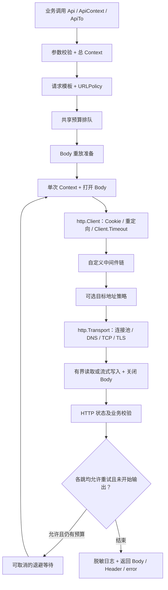

# requests 功能与架构说明

本项目是供 Go 业务程序调用的 HTTP 请求库。它负责构造请求、复用客户端、发送 HTTP 请求、控制超时与重试、读取响应、校验业务结果以及记录日志；没有独立监听端口、数据库或后台任务服务。

本次调整保留原有公开入口和主要能力，重点修复并发、错误传播、资源释放、流式上传和敏感信息暴露问题。安全默认值与原版本不同的地方见“兼容性与迁移”。

## 功能说明

### 请求入口

| 入口 | 用途 |
| --- | --- |
| `requests.Api(client, p)` | 原有入口，内部使用 Background Context |
| `requests.ApiContext(ctx, client, p)` | 继承调用方取消信号和期限 |
| `requests.ApiTo(ctx, client, p, dst)` | 将成功响应流式写入 Writer，返回写入字节数、Header 和 error |
| `requests.SetDefaultLimiter(limiter)` | 调整后续调用使用的默认共享预算 |
| `requests.NewClient(cmd)` | 原有客户端入口，配置错误时返回拒绝发送请求的 Client |
| `requests.NewClientChecked(cmd)` | 创建或复用配置相符的命名客户端，冲突直接返回错误 |
| `requests.GetClient(name)` | 只取得已有命名客户端，不重新提交配置 |
| `requests.NewClientUncached(cmd)` | 每次创建独立客户端，适合租户或动态配置 |
| `requests.NewPublicClient(cmd)` | 创建独立公网客户端，强制阻止非公网 IP 并禁用环境代理 |
| `tc.ContentBy...` | 构造 JSON、XML、文本、二进制、MsgPack 和表单 Body |
| `tc.FileBodyFactory(path)` | 为大型二进制文件创建可重放流 |
| `tc.FileBodyFactoryUnder(root, relative)` | 将外部相对路径限制在授权目录内，需 Go 1.24+ |
| `pf.GetRequestMeta/GetBusMeta` | 在自定义中间件中获取本次请求配置及请求总线 |
| `pf.ReadRequestBody/ReadResponseBody` | 有界读取并恢复 Body；也提供显式 Limit 版本 |

`Api` 和 `ApiContext` 返回 `([]byte, http.Header, error)`。失败时也可能返回部分或完整的错误正文及响应头，调用方应先检查 error，再决定如何处理这些数据。

支持 GET、POST、PUT、PATCH、DELETE、HEAD、OPTIONS、TRACE、CONNECT。方法需大写。HTTP/HTTPS URL 必须完整，禁止在 URL 中携带用户名和密码；认证使用请求头。

`Params` 追加到 URL 中已有的查询参数，同名键可以有多个值；非法百分号编码和未转义的分号会在发送前报错。`Header["Host"]` 设置的是 `Request.Host`；Content-Length 会解析、校验并设置到请求字段。显式声明 `Content-Length: 0` 时，在单次期限内最多探测一个字节确认空正文，非空正文在发送前拒绝，空流关闭后转为 `http.NoBody`。Transfer-Encoding 由 Go HTTP 层管理，不允许通过普通请求头覆盖。

### ApiParam 参数

| 参数 | 规则或默认值 |
| --- | --- |
| `Url / Method / Header / Params` | URL、方法、单值请求头、追加的查询参数 |
| `Body` | 一次调用拥有的 io.Reader，若支持 Close，会在成功或失败路径关闭 |
| `BodyFactory` | 每次尝试返回独立 io.ReadCloser、长度和 error；未知长度返回 -1；与 Body 互斥 |
| `SingleTimeout` | 单次尝试期限，默认 30 秒 |
| `Timeout` | 整次调用期限，0 自动计算 |
| `Retry` | 首次之外的额外尝试次数，范围 0～100 |
| `RetryInterval` | 固定间隔；0 时使用带抖动的指数退避 |
| `Backoff` | 可自定义退避，参数从第 1 次重试开始；优先于 RetryInterval |
| `MaxRetryDelay` | 单次等待上限，默认 30 秒，包含 Retry-After 的等待 |
| `AllowUnsafeRetry` | 显式允许有副作用的方法重试，默认 false |
| `RetryStatusCodes` | nil 默认 408、429、500、502、503、504；空切片关闭状态码重试 |
| `RetryValidation` | 显式允许业务校验失败后重试，默认 false |
| `RetryDecider` | 可覆盖普通失败的重试判断；不能绕过方法、永久错误、地址、容量和写入限制 |
| `EnableValid` | 是否启用业务验证，默认 false |
| `Validator` | 保留原有 `func([]byte, http.Header) (bool, error)` |
| `ContextValidator` | 支持 Context 的验证器，与 Validator 互斥 |
| `SuccessStatus` | 自定义 HTTP 成功状态；默认接受 200～299 |
| `MaxResponseBytes` | 响应正文上限，默认 16 MiB |
| `MaxErrorBytes` | 错误正文上限，默认 64 KiB；实际取其与 MaxResponseBytes 的较小值 |
| `MaxReplayBytes` | 一次性流的重试缓存上限，默认 8 MiB |
| `URLPolicy` | 初始地址和每次重定向的业务地址检查；不能替代实际拨号 IP 检查 |
| `MaxRedirects` | 最多跟随的重定向次数，0 默认 10，范围 0～100 |
| `AllowCrossOriginRedirect` | 允许不同协议、主机或有效端口之间跳转，默认 false |
| `AllowHTTPSDowngrade` | 允许 HTTPS 跳转 HTTP，按相邻两跳检查，默认 false |
| `AllowCrossOriginBody` | 允许跨源重放正文，默认 false，需要独立于重试配置授权 |
| `RedirectHeaderAllowlist` | 跨源可携带的头；nil 默认 Accept、Accept-Language、Content-Type、User-Agent；空切片全部移除 |
| `Limiter` | 多次调用共享的并发/正文容量预算；nil 使用默认 64 个调用、256 MiB |
| `EchoReq / EchoRes` | 开启请求/响应日志，默认关闭 |
| `LogBody` | 显式开启完整小型 JSON/表单的脱敏预览，默认关闭 |
| `LogBodyLimit` | 默认 4 KiB，允许配置到 64 KiB |
| `SensitiveFields` | JSON/表单日志预览中需要额外脱敏的字段名；跨源请求头由 RedirectHeaderAllowlist 控制 |
| `Logger` | 自定义 slog.Logger，默认 slog.Default() |
| `Caller / TraceId` | 日志中的调用方和跟踪标识 |

时间参数均为 `time.Duration`，例如 `500*time.Millisecond`。整数 `500` 表示 500 纳秒。

ApiParam 容量字段的 0 表示使用默认值，不表示无限制。负数、无效 URL、无效 Header、冲突配置以及错误的重试次数会被拒绝。`tn.NewLimiter(maxConcurrent, 0)` 是单独的构造器规则，表示只限制调用数。

### 超时与取消

总期限覆盖配额排队、Body 准备、各次请求、响应读取或流式写入、业务校验及重试等待；调用方 Context 期限更短时，以调用方为准。

一次尝试的 SingleTimeout 覆盖 BodyFactory 打开、显式零长度正文探测、HTTP 交互、响应读取或流式写入和业务校验。一次性流在首次发送前的重试缓存准备属于总期限。Client.Timeout 对其自身的 HTTP 交互和读取继续生效。

Timeout 未设置时，按以下方式计算，溢出时饱和到最大 Duration：

```text
总期限 = SingleTimeout × (Retry + 1) + 等待预算 × Retry
等待预算 =
  固定 RetryInterval 与 MaxRetryDelay 的较小值，或
  使用默认/自定义退避时的 MaxRetryDelay
```

实际等待可能受服务端 Retry-After 影响，总期限始终优先，因此配置了较短固定间隔时，服务端较长的等待建议可能导致整个调用超时。

取消错误保留 `context.Canceled` 或 `context.DeadlineExceeded`，可用 `errors.Is` 判断。超时后返回成功的验证器也会被纠正为超时。

任意用户代码无法被 Go 安全地强制终止。BodyFactory、ContextValidator、RetryDecider 和 URLPolicy 必须配合 Context；自定义流的 Close 应能解除阻塞的 Read。旧 Validator、不支持关闭的阻塞 Reader，以及不响应取消的 Writer.Write 可能延长实际返回时间。Backoff、SuccessStatus、日志输出和资源清理也同步执行，应使用能够及时返回的实现。本库不为这些回调创建无法回收的后台 goroutine。

内置文件工厂在 Unix 使用非阻塞打开并检查已打开文件的类型，拒绝 FIFO、目录和其他特殊文件，包括指向它们的符号链接。Context 会在打开和检查前后复核；网络文件系统等内核操作仍无法被 Context 强制中断，不应据此承诺任意文件系统都能立即取消。

### 重试规则

只有同时满足下列条件才会继续尝试：

1. 配置的 Retry 次数尚未用完，且总 Context 仍有效。
2. 初始请求及实际跟随的每一跳，方法为 GET、HEAD、OPTIONS，或显式设置 AllowUnsafeRetry，或携带非空 Idempotency-Key。
3. 遇到可重试状态码、临时网络故障、单次超时、不完整响应读取，或显式允许重试的业务校验失败。
4. 请求正文能够重新打开，或已经在容量上限内完成缓存。

业务校验失败默认不重试，临时业务状态可设置 `RetryValidation: true`。`RetryDecider(ctx, info)` 可覆盖普通失败的默认判断，`info.Attempt` 从 1 开始，`Header` 为独立副本。用 `tn.NoRetry(err)` 标记永久业务失败；该标记以及取消、证书错误、地址拒绝、Body 不可重放、容量超限和 Writer 写入错误都不能被 RetryDecider 放行。参数和 BodyFactory 打开错误在发送前返回。

整次显式重试会重新执行跳转链。跨源清理或自定义 CheckRedirect 导致某个非安全方法请求失去幂等键后，本次调用不再自动重试，即使最后一跳已经变成 GET。这个限制在目标请求发生网络错误、尚未拿到响应时也生效。只有显式 AllowUnsafeRetry，或让每个相关目标都携带且支持同一操作的幂等键，才可继续重试；不要为了重试而向未经授权的目标透传凭证。

默认指数退避基值 100 毫秒，指数部分最高 2 秒，在其一半到完整间隔之间加入抖动。显式设置 RetryInterval 可保留固定间隔；Backoff 可自定义。所有等待都响应取消，并受 MaxRetryDelay 限制。

Idempotency-Key 只有在服务端实现去重时才有意义；客户端不会提供“只执行一次”的事务保证。AllowUnsafeRetry 表示调用方承担重复操作的业务风险。Go Transport 自身可能对可重放请求进行透明连接重试，Retry 统计的是本库的显式重试。

### HTTP 状态和业务校验

HTTP 状态默认接受全部 2xx。若业务需要接受 304 等状态，可配置 SuccessStatus。

启用 EnableValid 且未传入验证器时，保留原约定：

```json
{"code": 200, "msg": "success"}
```

验证发生在重定向完成并读取最终响应之后。`false, nil`、任意非 nil error 和验证器 panic 都视为校验失败。`true, error` 不会被当作成功。原始业务错误通过包装保留，panic 内容不会写入错误信息。

常用错误判断：

```go
body, header, err := requests.ApiContext(ctx, client, p)

var statusErr *tn.HTTPError
switch {
case errors.Is(err, context.DeadlineExceeded):
    // 上游期限、总期限或单次尝试超时
case errors.As(err, &statusErr):
    // statusErr.StatusCode / Header / Body / Truncated
case errors.Is(err, tn.ErrResponseTooLarge):
    // 正文超限；不会将截断内容视为成功
case errors.Is(err, tn.ErrRequestBodyTooLarge):
    // 改为 BodyFactory，或明确提高 MaxReplayBytes
case errors.Is(err, tn.ErrTargetBlocked):
    // 地址策略拒绝
case errors.Is(err, tn.ErrClientConfig):
    // 客户端配置无效或命名缓存配置冲突
case errors.Is(err, tn.ErrAdmissionTooLarge):
    // 单次正文预算超过共享 Limiter 总容量
case errors.Is(err, tn.ErrResponseWrite):
    // ApiTo 的 Writer 写入失败，可能已有部分输出
case errors.Is(err, tn.ErrValidation):
    // HTTP 成功但业务验证失败
}
_ = body
_ = header
```

错误响应超限可能同时满足 HTTPError 和 ErrResponseTooLarge；请按业务需要安排判断顺序。HTTPError.Error() 不输出 URL 和 Body，但 error 对象及返回正文仍可能包含业务敏感信息，调用方不要直接写入公开日志。

### Body 构造和文件上传

| 构造方法 | 行为 |
| --- | --- |
| `ContentByJson([]byte)` | application/json，保留原字节，不负责 JSON 模式校验 |
| `ContentByXml([]byte)` | application/xml，保留原字节，不解析 XML |
| `ContentByRaw(string)` | text/plain |
| `ContentByBinary(any)` | []byte、*os.File 或 io.Reader；文件长度按当前偏移计算 |
| `ContentByMsgpack(map[string]any)` | application/x-msgpack |
| `ContentByXWFormUrlencoded(map[string]any)` | 标量、基础类型别名及一层切片/数组；切片编码为同名多值 |
| `ContentByFormData(map[string]any)` | 普通字段、FormFile 和 []FormFile；惰性 multipart 流 |
| `FileBodyFactory(path)` | 每次重新打开普通文件，适合大型二进制请求 |
| `FileBodyFactoryUnder(root, relative)` | 使用 os.Root 限制在授权目录内，拒绝目录穿越和符号链接逃逸；Go 1.23 明确返回不支持错误 |

不支持的表单值会返回错误，不再静默丢失字段。空切片不产生字段，整个表单没有有效字段时返回错误。

multipart 构造只生成小块 MIME 头和打开文件的方法，不打开文件、不启动 goroutine。文件读到哪个 part 才打开哪个文件，用完立即关闭。字段名、文件名拒绝 CR/LF/NUL；引号和非 ASCII 字符使用 MIME 标准编码；文件名移除路径部分。

FormFile.Content 保留三种语义：

- string：本地文件路径，每次发送独立打开，可重试。
- []byte：内存内容，可重试；调用过程中不得修改底层切片。
- io.Reader：一次性流；若需要重试，会受 MaxReplayBytes 限制。

本地文件路径必须来自可信配置，或先经过业务层授权。multipart 的字符串路径功能不适合直接接受外部用户提交的任意路径；文件名净化不等于文件访问授权。每次重试/重定向期间文件内容需保持稳定。

需要接受外部相对路径时，可使用 `BodyFactory: tc.FileBodyFactoryUnder(authorizedRoot, relativePath)`。root 本身必须经过授权，目录范围限制也不能替代目录内文件的业务权限检查。工厂只接受普通文件；Unix 下对 FIFO 及其符号链接使用非阻塞打开后拒绝。multipart 如需同样的目录权限控制，可在 BodyFactory 中为每次尝试打开受限文件并构造独立 multipart 流。

大型二进制文件：

```go
p := tn.ApiParam{
    Url:         "https://upload.example.com/files",
    Method:      "POST",
    Header:      map[string]string{
        "Content-Type": "application/octet-stream",
        "Idempotency-Key": operationID, // 服务端必须支持去重
    },
    BodyFactory: tc.FileBodyFactory(trustedPath),
    Retry:       2,
    Timeout:     2 * time.Minute,
    SingleTimeout: 30 * time.Second,
}
body, header, err := requests.ApiContext(ctx, client, p)
```

multipart 文件：

```go
reader, contentType, err := tc.ContentByFormData(map[string]any{
    "user": "alice",
    "tag": []string{"report", "daily"},
    "file": tc.FormFile{Filename: "report.csv", Content: trustedPath},
})
if err != nil {
    return err
}
_, _, err = requests.ApiContext(ctx, client, tn.ApiParam{
    Url: "https://upload.example.com/form",
    Method: "POST",
    Header: map[string]string{
        "Content-Type": contentType,
        "Idempotency-Key": operationID,
    },
    Body: reader,
    Retry: 2,
})
return err
```

Body 的所有权交给一次 Api 调用。创建 Body 后如果最终没有调用 Api，应自行关闭实现 io.Closer 的 Body。不要将同一个流交给并发调用；若需并发上传，分别创建 Body，或者让 BodyFactory 每次返回独立流。

Api/ApiContext 返回完整的有界响应字节切片；流式下载使用 ApiTo。

### 流式下载

`ApiTo(ctx, client, p, dst)` 将成功正文用固定 32 KiB 缓冲区复制到 Writer，返回 `(int64, http.Header, error)`。MaxResponseBytes 仍然限制写入量，超限时不会写入用于探测的额外字节。失败 HTTP 状态的正文按 MaxErrorBytes 有界读取，可从 `HTTPError.Body` 获取。

```go
written, header, err := requests.ApiTo(ctx, client, tn.ApiParam{
    Url:              downloadURL,
    Method:           "GET",
    Retry:            2,
    MaxResponseBytes:  1 << 30, // 明确限制为 1 GiB
    Timeout:          10 * time.Minute,
    SingleTimeout:    5 * time.Minute,
}, dst)
```

ApiTo 要求非 nil Context 和 Writer，且 `EnableValid=false`；返回成功前仍检查 HTTP 状态、容量和期限。库不会关闭 dst。写入开始后的任何失败都不自动重试；Writer 的错误即使发生在首次写入且返回 0 字节，也不会重试。只有尚未写入时的可重试 HTTP/读取错误才可能继续。文件下载应先写临时文件，检查 error 并成功关闭后再提交或重命名，避免将部分文件当成完成结果。

### 共享并发和正文预算

默认 Limiter 在进程内供 Api、ApiContext 和 ApiTo 共享，最多允许 64 个在途调用、256 MiB 预留正文容量。单个调用可通过 `p.Limiter` 使用业务共享实例；`SetDefaultLimiter` 只影响之后选择默认预算的调用，已取得的配额仍归还给原实例。

普通调用预留 MaxResponseBytes；需要缓存一次性上传流以重试时，额外预留 MaxReplayBytes。显式 Content-Length: 0 的流在单次期限内先验证空正文，验证成功后无需重试缓存或对应预算。ApiTo 预留 `min(MaxErrorBytes, MaxResponseBytes) + 32 KiB`。排队在预读正文之前发生，等待受总 Context 控制；所需预算超过 Limiter 总容量时直接返回 ErrAdmissionTooLarge。

因此，在其他参数均为默认值时，普通请求最多同时执行 `256 MiB / 16 MiB = 16` 个；需要默认重放缓存时最多为 `floor(256 MiB / 24 MiB) = 10` 个。流式调用受 64 个在途调用上限约束。实际响应较小也按配置上限预留，不能把 64 当作所有配置下的有效并发数。

```go
limiter, err := tn.NewLimiter(32, 512<<20)
if err != nil {
    return err
}
// 为同一业务的多次调用复用 limiter；每次新建实例无法形成共享限制。
p.Limiter = limiter
p.MaxResponseBytes = 8 << 20
```

NewLimiter 的 maxConcurrent 必须为正，字节容量不能为负；字节容量为 0 表示只限调用数。调高缓冲返回的 MaxResponseBytes 时也要满足共享预算；大下载优先使用 ApiTo。预算不包含 io.ReadAll 扩容、重试时仍保留的上一轮结果、用户回调、协议缓冲，以及调用结束后由业务保留的结果，因此不能当作进程峰值堆内存上限。

## 架构说明

### 模块职责

| 模块 | 职责 |
| --- | --- |
| 根包 requests | 请求/流式输出入口、共享预算配置及客户端选择 |
| tn | 请求/客户端配置、Limiter、BodyFactory/BodySource、上下文总线及结构化错误 |
| internal/runner | 配额排队、请求构造、超时、重放、重试、重定向、流式输出、校验与日志协调 |
| internal/core | Client 创建、连接池默认配置、LRU 缓存、网络访问策略 |
| mdw / interfaces | 自定义 RoundTripper 建链、克隆约定、内置兼容节点 |
| tc | 编码和惰性 multipart；文件流打开方法 |
| pf | 中间件元数据访问及受限 Body 读取辅助方法 |
| internal/lz | 有界读取、仅关闭一次、读取后恢复正文 |
| internal/validator | 默认业务验证及回调错误/panic 处理 |
| internal/utils / idgen | 类型转换、通用辅助和请求 ID |



重试置于 http.Client 之上，因此能覆盖完整的一次重定向过程，并对默认及自定义 Client 使用一致策略。BodyFactory 为本次尝试和 307/308 重定向生成独立流。

内置 RetryMiddleware、LoggingMiddleware 的类型和建链方式继续可用，普通调用的策略统一由 Api/ApiContext/ApiTo 执行，多个内置节点不会叠加重试和日志。直接 Client.Get/Do 在没有请求元数据时保持原生 HTTP 行为，不需要私有 Context。

兼容层仍支持手动向 Context 注入 `*tn.ApiParam` 的旧用法：内置节点委托给执行层，每一跳分别处理重试、校验和日志，3xx 交给外层 Client 跟随，并检查原始跨源边界及相邻两跳的 HTTPS 降级。这个旧入口的重试单位是单跳，推荐迁移到 ApiContext，以统一整次重定向链的期限和重试语义。

### 资源生命周期

1. Api 接管传入 Body；即使参数错误或调用方已取消，也清理可关闭的流。
2. 可重放字节流使用 GetBody，可重建文件使用 BodyFactory/BodySource，不提前缓存文件。
3. 只有需要显式重试的一次性流会进入有界缓存；读取失败直接返回原始错误。
4. 每次尝试独立创建 Context 和 Body；响应读完后关闭，随后取消该次 Context。
5. 响应超限或失败时关闭流，不无限排空可能由远端持续发送的数据；该连接可能无法复用。
6. 正常读取至 EOF 的响应由 Go HTTP 层归还连接池。
7. 缓存替换/淘汰调用 CloseIdleConnections，在途请求继续执行。
8. 调用结束不关闭整个共享 Client；调用方可以显式关闭其空闲连接。
9. 调用结束归还共享配额；流式 Writer 及其已写入的结果仍由业务持有和提交。

重复关闭通过同步保护，防止正常清理与取消回调同时关闭底层资源。流本身仍需满足 net/http 的 Read/Close 并发约定。

### 客户端缓存与连接池

ClientParam 包含 Timeout、SpaceName、Transport、Jar、Middlewares、MiddlewareFactories、CheckRedirect、Reset、NetworkPolicy 和 MaxConnsPerHost。

- 空 SpaceName 使用 master；同名且配置签名相符才返回同一 Client，更新使用 Reset。
- 命名缓存容量为 100，使用互斥锁保护 LRU 操作；不会重置正在并发使用的 sync.Map。
- Timeout、连接上限、NetworkPolicy、Transport、Jar 或中间件原型等配置冲突，返回 ErrClientConfig。
- CheckRedirect 和 MiddlewareFactories 等回调不能可靠比较；即使再次传入同一函数变量，也保守地视为配置冲突。函数或非指针值形式的 Transport/Jar/中间件身份也采用保守比较。
- 已有客户端用 GetClient 读取；动态回调或租户隔离用 NewClientUncached，SpaceName/Reset 在该入口不参与缓存。
- NewPublicClient 也不进入命名缓存；始终启用 BlockPrivateIPs，保留传入 NetworkPolicy 的 AllowedHosts，并拒绝自定义 Transport。
- NewClientChecked、NewClientUncached 和 NewPublicClient 在创建阶段返回错误；NewClient 保留旧签名，错误时返回拒绝发送请求的 Client。Transport/Jar 中保存的带类型 nil 均被拒绝，真正的 nil Jar 表示不启用 CookieJar。
- 命名缓存与 Api(nil, p) 的共享默认 Client 独立。
- 默认最大空闲连接总数 500，每目标最大空闲连接 100；每目标总连接上限默认 256，可配置。
- 默认空闲连接期限 90 秒，拨号预算 30 秒，TLS 握手预算 10 秒，Expect-Continue 等待 1 秒。
- 使用 HTTP/2 自动协商；不关闭证书校验。
- 未启用 NetworkPolicy 时支持环境代理；启用后禁用环境代理，确保 IP 检查发生在实际拨号处。
- 不再额外硬编码 5 秒的响应头超时；由单次请求/Client 期限控制。

缓存构造、用户工厂和空闲连接清理在锁外执行，避免慢回调、重入或 panic 锁住整个缓存。并发首次创建可能产生多个独立候选，提交时只保留一个，未采用候选会关闭空闲连接。

连接上限与请求并发数不同，尤其是 HTTP/2 多路复用场景。Api 系列的在途调用由共享 Limiter 控制；直接 Client.Do/Get 不经过该预算。应用仍需管理自身任务排队及返回结果的保留时间。

自定义 Transport 的池配置由调用方负责；不要并发修改已使用 Client/Transport 的字段。缓存淘汰不使外部保存的 Client 失效，因此长期自行持有大量 Client 时，资源总量不受缓存条目数限制。

### 中间件扩展约定

Middlewares 节点仍实现 RoundTripper、SetTransport、Name，且必须实现 `interfaces.Cloner` 返回独立节点；仅为每个 Client 手工创建实例、但不实现 Clone，仍会被拒绝。内置节点已实现 Clone，构建不会修改共享原型。

新代码可使用 `MiddlewareFactories`，每个工厂接收下游并返回独立、支持并发的 RoundTripper。工厂列表位于传统节点外侧，两份列表内部均按从外到内的顺序执行，不能返回跨客户端共享的可变节点。开始发送请求后不要继续 Add/Build 或修改下游。

Build 拒绝 nil、重复原型、返回原节点的 Clone 和已检测到的循环；NewClientChecked 将建链错误返回给调用方。中间件应遵守 RoundTripper 的并发、响应和 Body 关闭约定。链包装器优先调用最外层的 CloseIdleConnections；外层未实现时关闭基础 Transport 的空闲连接。自定义节点实现该方法时需继续向下游转发，自有其他资源由其所有者管理。

## 性能设计

| 原问题 | 调整 |
| --- | --- |
| 重试、日志、返回值多次读取同一个响应 | 在执行层有界读取一次，验证及日志复用该切片 |
| 任意上传流提前读完，文件大小决定内存占用 | 可重建流直接发送，普通文件/multipart 路径按需打开 |
| multipart 创建即启动管道生产者 | 同步惰性顺序流，不创建生产者 goroutine |
| 日志预读完整请求/响应 | 开启预览时随发送捕获小前缀，默认日志完全不读取 Body |
| 缓存超过容量后整体重置 | 容量受限的 LRU，仅淘汰最近最少使用项 |
| 无限连接增长、频繁新建连接 | 客户端复用、连接池上限、空闲连接清理 |
| 并发请求在等待连接前就预缓存大量正文 | Limiter 在预读之前预留共享并发/容量预算 |
| 大下载必须完整进入响应切片 | ApiTo 使用固定 32 KiB 复制缓冲，保留容量和错误处理规则 |
| 失败时立即密集重试 | 指数退避、抖动、服务端 Retry-After 和总期限 |
| 表单字段转换用格式化分配字符串 | 基础类型用 strconv，支持别名且拒绝不支持的值 |

读取上限限制的是保留的正文数据量。io.ReadAll 的扩容、解析/验证器以及用户日志 Sink 仍可能带来额外分配，不能将 MaxResponseBytes 直接当作进程峰值内存。

本地基准用于验证执行开销和流式分配，不代表线上吞吐。测试机为 Apple M3 Max / darwin arm64；最终数据见“验证记录”。

## 安全设计

### 敏感日志

EchoReq/EchoRes 启用后使用结构化 slog，默认只输出请求 ID、TraceId、Caller、方法、origin、状态、耗时和脱敏头。

- 不记录 URL 的路径、查询参数或 URL 用户信息，避免路径令牌泄漏。
- 请求/响应头仅允许 Content-Type、Content-Length、Accept 原值，其他值统一脱敏。
- Body 预览默认关闭。开启后仅处理完整且不超限的 JSON/URL 表单。
- 密码、token、cookie、secret、authorization、apikey、credential、session、privatekey 等字段及自定义 SensitiveFields 会脱敏；JSON 递归处理。
- 非法 JSON、截断 JSON、大 Body、二进制、multipart、XML、纯文本整体省略。
- 日志不输出原始 error.Error()，防止其携带凭证 URL 或正文；记录错误类型。
- 请求/响应各输出一条完成日志。慢请求期间不会预先打印完整 Body。

字段规则不能识别任意自然语言中的秘密，也不是完整的个人信息识别器。处理敏感业务时保持 LogBody=false，或显式配置字段与受控的日志 Sink。Caller/TraceId 也应由业务填入适合记录的信息。

### 出站访问策略

兼容内网调用是原需求，因此 NetworkPolicy 默认未开启。若目标 URL 受外部输入影响，应显式启用受限客户端：

```go
client, err := requests.NewPublicClient(tn.ClientParam{
    NetworkPolicy: &tn.NetworkPolicy{
        AllowedHosts: []string{"api.example.com"},
    },
})
if err != nil {
    return err
}
```

NewPublicClient 始终启用 BlockPrivateIPs；需要命名缓存时可用 NewClientChecked 并显式设置 NetworkPolicy。AllowedHosts 是精确主机名或 IP 列表，不接受通配符、端口、URL；国际化域名需提供 ASCII/Punycode。空列表不限制主机名。若需限制端口、路径或强制 HTTPS，再配置 URLPolicy。

启用策略后，内置 Transport 在每次目标请求检查主机名，DNS 解析后检查全部候选 IP，再直接拨号至已检查的 IP。IP 检查覆盖环回、内网、链路本地、IPv4 映射 IPv6、常见保留/特殊网段等；混合解析结果中有被拒绝地址时整体拒绝。DNS 与拨号共享时间预算，TLS 仍校验原始目标主机名。

此模式不允许自定义 Transport，并禁用环境代理，避免通过另一套拨号路径绕过检查。自定义中间件属于可信代码；若其自行发起额外网络请求，库无法替代系统级出站防火墙。业务层仍需对目标服务、路径、端口和操作进行授权。

URLPolicy 检查初始地址及每次实际跟随的重定向。默认拒绝跨源跳转；授权 AllowCrossOriginRedirect 后，仍需单独授权跨源正文重放。HTTPS 降级按相邻两跳判断，因此 HTTP→HTTPS→HTTP 中的第二次跳转也需要 AllowHTTPSDowngrade。自定义 CheckRedirect 先执行，随后检查其最终修改的目标、请求头和重试资格，不能借回调绕过这些限制。

允许跨源跳转时按 RedirectHeaderAllowlist 清理请求头，默认只保留 Accept、Accept-Language、Content-Type、User-Agent，Authorization、Cookie、自定义认证头和 Referer 都会移除。CookieJar 跨源取 Cookie 也默认禁用，只有显式将 Cookie 列入白名单才继续采用 Jar 的域规则。Cookie 本身仍不按端口隔离，租户隔离应使用独立 Jar/Client。被移除的 Idempotency-Key 不会为了重试而自动补回；未启用 AllowUnsafeRetry 时，非安全方法失去幂等键后停止后续重试。

拒绝 307/308 重定向时，已通过 GetBody 重开的上传流也会关闭，包括 ErrUseLastResponse 分支。

### 工具链和依赖

go.mod 保留 `go 1.23.3` 的源码最低版本声明，并设置 `toolchain go1.26.9` 作为项目默认构建版本。生产不应使用已停止维护的旧工具链。

Go 1.26.9 包含 net/http、net/textproto、crypto/tls 等安全修复；支持周期和版本记录以 [Go 官方发布说明](https://go.dev/doc/devel/release) 为准。依赖本库的主模块不继承本库的 toolchain 设置，需要独立配置构建工具链。

运行时依赖保持原固定版本，没有新增第三方运行时依赖。使用 [Go 官方 govulncheck](https://go.dev/doc/security/) 检查当前代码可达的已知漏洞；扫描结果只代表扫描时的代码、工具链和漏洞数据库，不替代后续持续更新。

## 兼容性与迁移

| 项目 | 现在的行为及迁移方式 |
| --- | --- |
| Api / NewClient / tc 构造方法 | 原有函数及参数名保留；新增 Context、ApiTo、Checked、独立客户端和 Factory 入口 |
| Retry 含义 | 仍为额外次数；负数或超过 100 明确拒绝 |
| 非安全方法重试 | POST/PUT/PATCH/DELETE 等需安全开关或有效 Idempotency-Key；任何跳转失去保护后停止整次调用的后续重试 |
| 业务重试 | 校验失败默认不重试；临时状态启用 RetryValidation，永久错误用 tn.NoRetry 标记 |
| 重定向 | 默认拒绝跨源和任意一跳的 HTTPS 降级；正文重放单独授权，跨源头和 Jar 均受白名单约束 |
| Client.Timeout | 直接使用 time.Duration，不再错误地再次乘以 time.Second |
| 返回状态 | 全部 2xx 默认成功；如必须只接受 200，设置 SuccessStatus |
| 非 2xx | 返回有界 Body/Header 和可 errors.As 的 HTTPError |
| Body 大小 | 默认响应 16 MiB、错误 64 KiB、重放 8 MiB；较大业务显式调高或使用流式工厂 |
| 大响应及并发 | ApiTo 支持固定缓冲下载；缓冲返回同时受 MaxResponseBytes 和共享 Limiter 预算限制 |
| Content-Length: 0 | 发送前确认空正文；有数据即拒绝，避免隐式变成 chunked 上传 |
| 文件工厂 | 只接受普通文件；Unix 非阻塞打开防止 FIFO 挂死，受限目录入口需要 Go 1.24+ |
| Jar / CheckRedirect | 配置实际生效，重定向完成后才做业务校验 |
| 业务验证 | 保留 EnableValid 及默认 code/msg；非 nil error 优先于 true |
| 读流错误 | 不再被忽略，部分数据不会伪装成完整成功 |
| EchoReq / EchoRes | 保留开关，默认脱敏元数据；Body 预览需另开 LogBody |
| 中间件 | 传统节点必须实现 Clone，也可提供工厂；内置兼容入口仍支持旧 Context 元数据，推荐 ApiContext |
| multipart | 仍支持文件路径、字节、Reader；按需读取，不再创建即运行后台管道 |
| 表单未知类型 | 明确报错，避免静默丢字段；新增支持基础类型别名和 URL 表单多值 |
| URL credentials | 拒绝 user:password@host，改用认证头 |
| 客户端复用 | 同名且配置相符才复用；GetClient 显式取已有实例，Reset 替换，动态回调使用独立客户端 |
| nil 客户端配置 | 真正的 nil 使用默认语义；接口中保存的带类型 nil Transport/Jar 返回 ErrClientConfig |
| Go 工具链 | 源码最低版本保留，默认构建使用安全补丁版本 |

只需要旧式调用的代码可继续使用 Api；建议上游 HTTP 服务将 r.Context() 传给 ApiContext，让用户取消能够及时传递到出站调用。

## 本轮复核修复

修复日期：2026-10-17。

| 问题 | 修复结果 | 回归场景 |
| --- | --- | --- |
| 跨源清理幂等键后仍重试 POST | 每跳复核；未启用 AllowUnsafeRetry 时，非安全方法丢失幂等键后停止整次调用的后续重试 | 503、网络错误、最终变为 GET、自定义 RetryDecider、显式保留幂等键和允许非安全重试 |
| HTTP→HTTPS→HTTP 绕过降级检查 | 使用上一跳 URL 判断 HTTPS 降级 | Api 和旧中间件入口均覆盖默认拒绝及显式允许 |
| 文件工厂打开 FIFO 时无法取消 | Unix 非阻塞打开后检查文件类型，关闭被拒绝的描述符 | 普通及目录受限工厂，FIFO 与指向 FIFO 的符号链接 |
| 带类型 nil CookieJar 导致 panic | 创建阶段返回 ErrClientConfig，旧构造器返回拒绝发送的 Client | 命名、独立、公网及旧签名客户端入口 |
| Content-Length: 0 意外发送 chunked 正文 | 最多探测一个字节，非空流拒绝，空流关闭并转为 NoBody | Reader、BodyFactory、BodySource、取消、只提供首字节的流、空流重试及预算 |

回归用例位于 `redirect_safety_test.go`、`request_boundary_test.go` 和 `tc/file_open_unix_test.go`。测试同时检查错误传播、跳转次数、实际 HTTP 序列化及正文关闭次数。

## 验证记录

记录日期：2026-10-17。

- Go 1.23.3：完整回归测试通过，用于验证最低声明版本的源码兼容性；受限目录文件入口在此版本明确拒绝。
- Go 1.24.2：tc 包测试通过，验证 os.Root 文件打开及目录限制的最低功能版本；此记录仅用于兼容性确认。
- Go 1.26.9：回归测试、竞态检测、go vet 及基准测试通过。
- Linux/amd64、Windows/amd64：交叉构建通过；Linux/amd64 的 tc 测试二进制编译通过，未在这些目标系统执行测试。
- govulncheck：使用 Go 1.26.9 扫描，结果为 `No vulnerabilities found.`。
- 所有功能测试使用本机 httptest 或内存 Transport，不访问原有业务测试站点。

测试覆盖请求头/查询参数、2xx、错误正文及超限、HTTP 状态及业务重试、逐跳方法保护、Body 重放及关闭、读取错误、取消、Retry-After、验证器错误/panic、多跳重定向、Cookie、gzip 解压后容量限制、multipart 重试、流式输出、共享配额、日志脱敏、命名缓存并发、LRU 淘汰、地址策略，以及本轮 5 项问题的回归场景。

Go 1.26.9 本地基准结果（单次采样）：

| 基准 | 时间 | 堆分配 | 分配次数 |
| --- | --- | --- | --- |
| Api，小 JSON 响应，内存 Transport，日志关闭 | 3,106 ns/op | 5,184 B/op | 55 allocs/op |
| multipart，8 MiB 本地文件，流式读到 io.Discard | 788,300 ns/op | 2,899 B/op | 57 allocs/op |

文件基准使用临时普通文件及系统文件缓存；2,899 B/op 表明本次路径没有将整个 8 MiB 文件缓存进 Go 堆，不代表整个进程或内核的内存占用。

复现命令：

```sh
go test ./...
go test -race ./...
go vet ./...
go test ./... -run '^$' -bench . -benchmem
govulncheck ./...

# 仅用于确认旧版本源码兼容性；不要用于生产构建
GOTOOLCHAIN=local go test ./...
```

基准不包含远端网络时延、TLS 握手和真实磁盘冷读，不能直接换算服务吞吐，也没有据此宣称相对旧版本的百分比提升。
